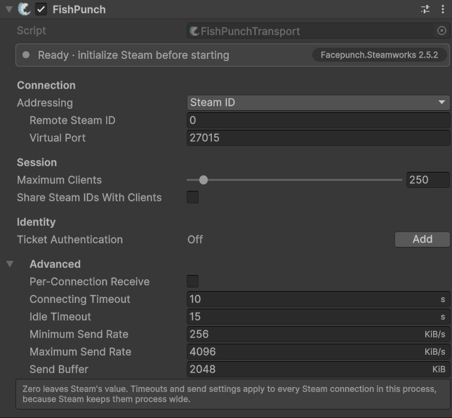

# Fishpunch (Steam)

## Description

FishPunch is a transport that connects FishNet to Steam Networking Sockets using the [Facepunch.Steamworks](https://github.com/Facepunch/Facepunch.Steamworks) API.\
\
Players can host and join each other by SteamID through Valve's relay, dedicated servers can run as Steam game servers behind a Fake IP, and two processes can also connect directly by IPv4 or IPv6 address.


FishPunch is much improved over the older [fishyfacepunch-steam.md](fishyfacepunch-steam.md "mention") transport.


***

## Compatibility

<table data-full-width="false" data-search="false"><thead><tr><th width="149">System</th><th width="198">Supported?</th></tr></thead><tbody><tr><td>Windows</td><td><mark style="color:green;">Fully Supported</mark></td></tr><tr><td>MacOS</td><td><mark style="color:green;">Fully Supported</mark></td></tr><tr><td>Linux</td><td><mark style="color:green;">Fully Supported</mark></td></tr><tr><td>Web</td><td><mark style="color:red;">Not Supported</mark></td></tr><tr><td>IOS</td><td><mark style="color:red;">Not Supported</mark></td></tr><tr><td>Android</td><td><mark style="color:red;">Not Supported</mark></td></tr><tr><td>Xbox</td><td><mark style="color:red;">Not Supported</mark></td></tr><tr><td>PlayStation</td><td><mark style="color:red;">Not Supported</mark></td></tr><tr><td>Nintendo</td><td><mark style="color:red;">Not Supported</mark></td></tr></tbody></table>

***

## How to install

FishPunch requires Unity 2022.3 or later, FishNet 4.7 or later, and Facepunch.Steamworks 2.5.2 or later.

1. Import FishNet.
2. In the Package Manager, select **+ > Install package from git URL** and add:\
   `https://github.com/maxkratt/fishpunch.git`
3. Add **FishNet > Transport > FishPunch** to your NetworkManager's GameObject and assign it to the [TransportManager](../components/managers/transportmanager/).

If your project does not have Facepunch.Steamworks yet, press **Import Facepunch.Steamworks 2.5.2** on the FishPunch Transport inspector, or use **Tools > FishPunch > Import Facepunch.Steamworks**. If you already have it, FishPunch will find and use your copy.


FishPunch never initializes, updates or shuts down Steam. Your game must call `SteamClient.Init(appId, false)` before starting and `SteamClient.RunCallbacks()` every frame, or use `SteamServer` on a dedicated server. The **Shared** sample's `SteamBootstrap` handles this and is a good starting point.


For full usage details, samples and API documentation, visit the GitHub page: [https://github.com/maxkratt/fishpunch](https://github.com/maxkratt/fishpunch)

***

## Component settings

<figure><figcaption>
Default settings
</figcaption></figure>

* **Addressing:** How the server is reached. Default is Steam ID.
  * **Steam ID:** Clients connect through Valve's relay using the host's SteamID64. No port forwarding is needed.
  * **IP Address:** Clients connect directly to an IPv4 or IPv6 address.
  * **Fake IP:** Clients connect to a game server by the fake address Steam granted it, so its real IP stays hidden.
* **Remote Steam ID:** Steam ID only. The SteamID64 a client connects to. Zero joins this peer's own server.
* **Remote Address:** IP Address and Fake IP only. The address a client connects to, such as `203.0.113.7:27015` or `[2001:db8::7]:27015`. Host names are not looked up.
* **Port:** Steam's virtual port when using Steam ID, or the UDP port an IP Address server listens on. The server and clients must agree. Ignored by Fake IP. Default is 27015.
* **Bind Address:** IP Address servers only. The local address to listen on. Empty listens on every interface.
* **Maximum Clients:** The most clients the server accepts at once. A host's own client takes one place. Default is 250.
* **Connecting Timeout Seconds:** How long a connection attempt may take before Steam gives up. Default is 10.
* **Idle Timeout Seconds:** How long a peer waits without hearing from the other side before the connection drops. Default is 15.

#### Send tuning

* **Send Rate Minimum Bytes Per Second:** The rate Steam never sends slower than. Default is 256 KiB/s.
* **Send Rate Maximum Bytes Per Second:** The rate Steam never sends faster than. Default is 4 MiB/s.
* **Send Buffer Bytes:** How much Steam may hold queued per connection. Default is 2 MiB.
* **Per Connection Receive:** Servers only. Receives each client through its own call, which avoids per-message allocations under IL2CPP. Default is off.


For the timeout and send settings, zero leaves Steam's own value. Steam applies these to the whole process, so they also affect any other Steam connection your game makes.


#### Identity

* **Share Steam IDs With Clients:** Tells every client the SteamID of every other client once FishNet authenticates it, read through `SharedSteamIds`. Set it the same on the server and every client.

The optional `SteamTicketAuthenticator` component can also be added from the inspector. It only admits clients once Steam confirms their auth ticket and that they own the game.
